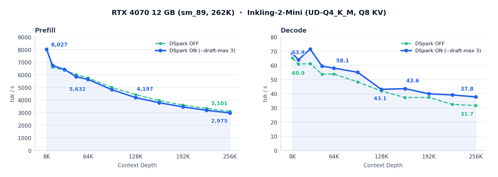
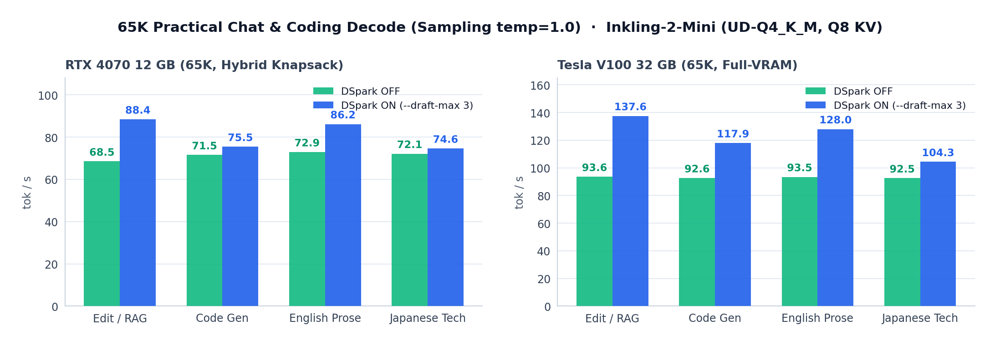
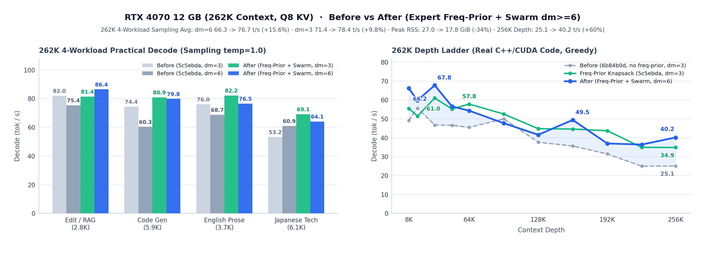
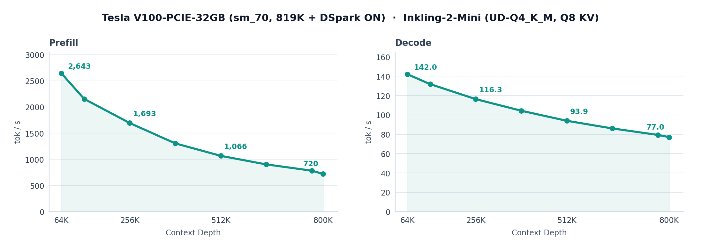
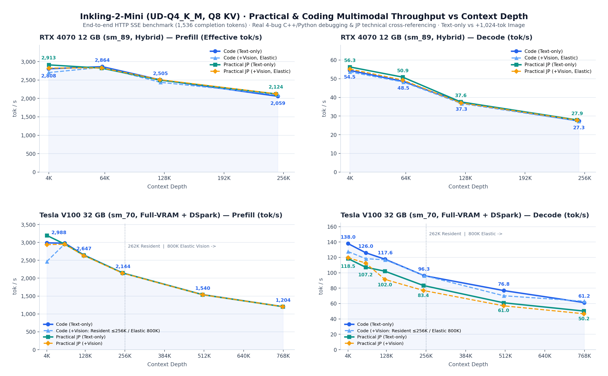
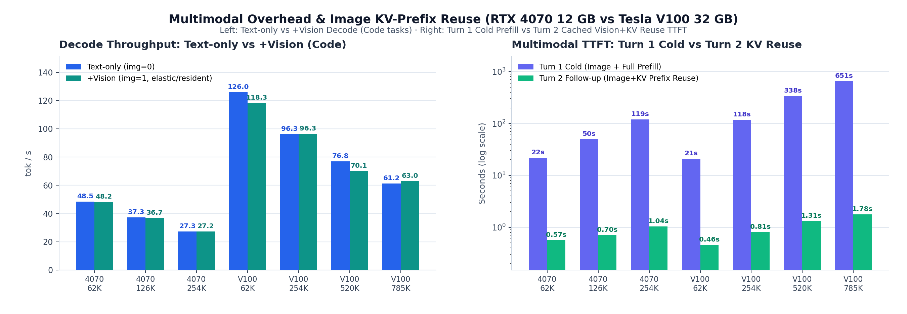

<div align="center">

# Strata — Inkling-2-Mini Edition

**High-throughput, long-context CUDA + AVX2 hybrid inference for Inkling-2-Mini.**

[](https://github.com/kuraneko1/Strata)
[](docs/INKLING2.md)
[](#supported-hardware--auto-profiles)
[](LICENSE)

[Highlights](#highlights) · [Profiles](#supported-hardware--auto-profiles) · [Benchmarks](#benchmarks) · [Build](#build-from-source) · [Quick Start](#quick-start) · [Architecture](#architecture--optimizations)

</div>

---

**`kuraneko1/Strata`** is a fork of [Niko1221/Strata](https://github.com/Niko1221/Strata) focused on **`strata-inkling2`**: a dedicated CUDA + AVX2 hybrid inference engine for the **Inkling-2-Mini** (`inkling2`) looped-MoE architecture.

It runs **65K–262K** context on a single **12 GB consumer GPU (RTX 4070)** and **819K–1M** context on a **32 GB Tesla V100** with **zero quantization or precision changes**, served behind an OpenAI- and Anthropic-compatible HTTP API and built-in Web UI (`serve.server`).

## Highlights

- **Zero-knob automatic tuning (`SM arch × VRAM regime`)** — Choose `--max-context` (and optionally `--draft` for DSpark). The engine inspects the GPU architecture and live free VRAM to select the verified chunk size, KV allocation policy, staging budget, FA2 split-K width, and CUDA Graph mode via [profile_rules.hpp](engine/include/strata/inkling2/profile_rules.hpp).
- **Zero quantization / precision compromises** — Native `UD-Q4_K_M` weights and `Q8` KV cache (`--kv-q8`), verified for `64/64` greedy token parity across optimization rounds.
- **Decode Frequency-Prior & Cross-Layer Knapsack Expert Caching** — Seeds VRAM expert slots from measured decode routing frequencies ([inkling2_expert_prior.cuh](engine/src/inkling2/inkling2_expert_prior.cuh)), applies Bayesian eviction/rebalancing during decode, and runs a Phase-Decode Cross-Layer Knapsack (`Core=128` + Outer knapsack at `65K–128K`, global 24-layer knapsack at `160K–256K`), lifting RTX 4070 `262K` decode to **`68.5–71.5 t/s`** (`8K–32K`), **`58.1 t/s`** (`64K`), **`55.1 t/s`** (`96K`), **`43.6 t/s`** (`160K`), **`40.0 t/s`** (`192K`), and **`37.8 t/s`** (`256K` ON, **`31.7 t/s`** OFF).
- **Host RAM Reduction (-51% to -57% RSS) & High-K Tailing** — `MADV_DONTNEED` raw mmap trimming with full-speed pinned PCIe DMA + `16 MiB` double-buffered staging fallback (`copy_h2d_staged`), Verify CUDA Graph capture up to `T<=9`, single-pass `Q5_K+Q8_0` AVX2 (`nt=5..8`), and balanced 8-thread remainder splits lift `262K` `Draft-3` sampling avg to **`80.8 t/s`** (prose **`84.6 t/s`**, Japanese **`73.9 t/s`**) and `256K` ladder decode to **`37.8 t/s`** (`2,975 t/s` cumulative prefill), while cutting peak host RSS by **`-51% to -54%` at `262K`** (`25.3–27.0 → 12.2 GiB`) and **`-57%` at `65K`** (`~26.5 → 11.0 GiB`).
- **Distribution-Preserving Sampling DSpark + 1-Hot PLD** — Deterministic-peak sampling confidence gating (`draft_sampled_confident`) and exact rejection-sampled 1-hot suffix drafting (`PromptSuffixDrafter`) preserve `temperature=1.0` sampling distributions while eliminating Japanese regressions (`65K` sampling: **`68.5–72.9 t/s`** OFF → **`74.6–88.4 t/s`** ON on RTX 4070; **`92.5–93.6 t/s`** OFF → **`104.3–137.6 t/s`** ON on V100 32 GB).
- **Fast on both 12 GB hybrid and 32 GB full-VRAM GPUs** — On RTX 4070 12 GB, a single `--max-context 262144` run on real C++/CUDA code reaches **`8,052 t/s` prefill** (`3,101 t/s` cumulative @ `256K` DSpark OFF; `7,874 t/s` warm / `8,010 t/s` cool @ `8K`, `2,935 t/s` @ `256K` DSpark ON). On V100 32 GB (GPU 0, ECC Off), all 3,072 experts fit in VRAM up to `819K` with DSpark (`135–167 t/s` decode at `64K–256K`, `109.5 t/s` at `512K`, `89.9 t/s` at `800K`, `192.8 t/s` at `512`).
- **Drop-in OpenAI & Anthropic API** — Works directly with Claude Code, Codex CLI, OpenCode, and other local coding agents, plus upstream Strata's Qwen3.8-Flash-Next and Qwen3.6-35B-A3B engines.

## Supported Hardware & Auto-Profiles

The profile selector separates **SM architecture** (`sm70`, `sm89`, `generic`) from **VRAM regime** (`full_vram`, `core_resident_hybrid`, `tight_hybrid`) so tuning for 12 GB Ada GPUs never regresses 32 GB Volta GPUs (and vice versa).

| Verified GPU | `--max-context` | Auto-Resolved Profile | Prefill Chunk | KV Cache Strategy | Expert Placement |
| --- | ---: | --- | ---: | --- | --- |
| **RTX 4070 12 GB** (`sm_89`) | `65536` | `sm89 + core_resident_hybrid` | `4096` (adapt. `<= 8192`) | Dynamic `16K → 36K → 65K` | `tier1` `100%` + Decode Frequency-Prior Outer Knapsack (`~90–92%` decode hit) |
| **RTX 4070 12 GB** (`sm_89`) | `131072` | `sm89 + core_resident_hybrid` | `4096` (adapt. `<= 8192`) | Dynamic `16K → 36K → 69K → 131K` | `tier1` `100%` + Decode Frequency-Prior Outer Knapsack |
| **RTX 4070 12 GB** (`sm_89`) | `262144` | `sm89 + tight_hybrid` | `2048` (adapt. `<= 12288`, `4096` w/ Core borrow) | Dynamic `16K → 36K → 69K → 102K → 139K → 172K → 204K → 262K` | Phase-Decode Cross-Layer Knapsack (`62.4%–71.4%` hit @ `262K`; `84.8%–85.9%` @ `128K`) |
| **Tesla V100 32 GB** (`sm_70`) | `819200` (+ DSpark) | `sm70 + full_vram` | `1024` | Upfront `819K` | `3,072 / 3,072` (`100%` VRAM, `916 MiB` free) |
| **Tesla V100 32 GB** (`sm_70`) | `1048576` | `sm70 + core_resident_hybrid` | `1024` | Dynamic | `2,897 / 3,072` (`tier1` `100%`) |

> **Other NVIDIA GPUs (`sm_75+`)**: Turing (`sm_75`), Ampere (`sm_86`), other Ada (`sm_89`), and Blackwell (`sm_120`, CUDA 13+) GPUs build and run via the safe `generic` profile and automatic VRAM sizing. Hardware verification and dedicated profiles currently cover **RTX 4070 12 GB** and **Tesla V100 32 GB**.

## Benchmarks

All numbers measured on real hardware with `Inkling-2-Mini-UD-Q4_K_M.gguf` (`--kv-q8`, zero quantization change).

### RTX 4070 12 GB (`sm_89`, Ryzen 7 5700X, 262K Single Profile)

Apples-to-apples real tokenized C++/CUDA code context ladder (`--max-context 262144 --kv-q8 --serve`, identical prompts & `n_gen=128` for both DSpark ON and DSpark OFF; `8K` = fresh empty-KV turn, `16K–256K` = continuous multi-turn sweep cumulative effective prefill & steady-state decode):

<p align="center">
  
</p>

| Context Depth | DSpark ON (`--draft-max 3`) Prefill | DSpark ON Decode | DSpark OFF Prefill | DSpark OFF Decode | GPU Hit (ON / OFF) |
| ---: | ---: | ---: | ---: | ---: | ---: |
| `8K` (fresh) | `8,027.1 t/s` | **`68.5 t/s`** | **`8,051.9 t/s`** | `65.2 t/s` | `86.1%` / `86.3%` |
| `16K` | **`6,740.7 t/s`** | **`63.9 t/s`** | `6,612.9 t/s` | `60.9 t/s` | `86.2%` / `86.4%` |
| `32K` | **`6,427.2 t/s`** | **`71.5 t/s`** | `6,365.5 t/s` | `61.2 t/s` | `86.1%` / `86.3%` |
| `48K` | `5,850.6 t/s` | **`59.4 t/s`** | **`6,014.0 t/s`** | `53.8 t/s` | `86.4%` / `86.2%` |
| `64K` | `5,632.1 t/s` | **`58.1 t/s`** | **`5,753.5 t/s`** | `53.9 t/s` | `86.6%` / `86.2%` |
| `96K` | `4,821.6 t/s` | **`55.1 t/s`** | **`4,999.2 t/s`** | `48.3 t/s` | `87.2%` / `86.0%` |
| `128K` | `4,197.1 t/s` | **`43.1 t/s`** | **`4,425.7 t/s`** | `42.0 t/s` | `84.8%` / `85.9%` |
| `160K` | `3,784.9 t/s` | **`43.6 t/s`** | **`3,955.5 t/s`** | `37.3 t/s` | `77.2%` / `84.7%` |
| `192K` | `3,451.7 t/s` | **`40.0 t/s`** | **`3,605.1 t/s`** | `37.4 t/s` | `73.2%` / `76.6%` |
| `224K` | `3,181.9 t/s` | **`39.1 t/s`** | **`3,325.1 t/s`** | `32.4 t/s` | `64.6%` / `71.2%` |
| `256K` (`261.5K`) | `2,975.4 t/s` | **`37.8 t/s`** | **`3,100.6 t/s`** | `31.7 t/s` | `66.9%` / `71.4%` |

<p><sub>Measured on current <code>main</code> after host-pinning and <code>MADV_DONTNEED</code> optimizations (<code>prebuild_tier1_hblobs</code> enabled).</sub></p>

> **Why RTX 4070 `262K` now pushes `71.5 t/s` at `32K`, `58.1 t/s` at `64K`, `55.1 t/s` at `96K`, and `37.8 t/s` at `256K` while Prefill hits `8,027 t/s` at `8K` and `2,975 t/s` at `256K`**: Combining Static Decode Frequency Prior ([inkling2_expert_prior.cuh](engine/src/inkling2/inkling2_expert_prior.cuh)) + Bayesian `rebalance()` + Phase-Decode Cross-Layer Knapsack (`Case A`: `Core=128` + Outer knapsack when Core fits; `Case B`: global 24-layer knapsack under tight `160K–256K` VRAM) with Phase-Split dynamic offload/reload, the 7-step KV ladder, upfront Tier-1/2 pinned host blobs + `MADV_DONTNEED`, multi-layer Core borrow (`blk.6..7`), overlapped `aux_st` DSpark + LM head execution, zero-copy AVX2 `nvfp4`/`q5k`/`q8_0` ktile CPU MoE kernels, and Distribution-Preserving Confidence-Gated DSpark + 1-Hot `PLD` lifts decode across every context depth with zero precision loss.

### `65K` Practical Chat & Coding (`Sampling temp=1.0`, RTX 4070 12 GB & Tesla V100 32 GB)

Realistic live-server sampling (`temperature=1.0, top_p=0.95, top_k=40`, 256 generated tokens across 4 diverse prompts) at `65K` context:

<p align="center">
  
</p>

| Workload (`65K`, `temp=1.0`) | RTX 4070 OFF | RTX 4070 ON (`--draft-max 3`) | 4070 Delta | Tesla V100 OFF | Tesla V100 ON (`--draft-max 3`) | V100 Delta |
| :--- | ---: | ---: | ---: | ---: | ---: | ---: |
| `edit_rag` (Code Edit / RAG) | `68.5 t/s` | **`88.4 t/s`** | **`+29.1%`** | `93.6 t/s` | **`137.6 t/s`** | **`+47.0%`** |
| `code` (C++/CUDA Gen) | `71.5 t/s` | **`75.5 t/s`** | **`+5.5%`** | `92.6 t/s` | **`117.9 t/s`** | **`+27.3%`** |
| `prose` (English Tech) | `72.9 t/s` | **`86.2 t/s`** | **`+18.2%`** | `93.5 t/s` | **`128.0 t/s`** | **`+37.0%`** |
| `japanese` (Japanese Tech) | `72.1 t/s` | **`74.6 t/s`** | **`+3.4%`** | `92.5 t/s` | **`104.3 t/s`** | **`+12.8%`** |

Full RTX 4070 Roofline ceiling, achievement rates & `--draft-max` / sampling gate analysis: [2026-11-26 RTX 4070 262K Roofline & DSpark Report](docs/bench-results/2026-11-26-rtx4070-262k-roofline-dspark/README.md) ([2026-11-22 progression](docs/bench-results/2026-11-22-rtx4070-inkling2-262k/README.md)).

### `262K` Before vs After (Frequency-Prior + High-K `--draft-max 6`, RTX 4070 12 GB)

Apples-to-apples `--max-context 262144 --kv-q8 --serve` (`Sampling temp=1.0, top_p=0.95, top_k=40`, `256` generated tokens across 4 diverse prompts) comparing prior `5c5ebda73` (Frequency-Prior + EMA `0.92`) against the updated engine (Frequency-Prior + `Q5_K` 1-pass AVX2, host RSS `-34%`, Verify graphs `T<=9`, high-K tail gating), alongside the `8K → 256K` real C++/CUDA depth ladder:

<p align="center">
  
</p>

| `262K` Setting | `edit_rag` | `code` | `prose` | `japanese` | 4-Workload Avg | Peak Host RSS |
| :--- | ---: | ---: | ---: | ---: | ---: | ---: |
| Before `dm=0` (`5c5ebda73`) | `60.50 t/s` | `59.16 t/s` | `67.06 t/s` | `59.38 t/s` | `61.53 t/s` | `26,238 MiB` |
| After `dm=0` | `70.93 t/s` | `72.27 t/s` | **`71.46 t/s`** | **`71.69 t/s`** | **`71.59 t/s`** (`+16.3%`) | **`17,160 MiB`** (`-34.6%`) |
| Before `dm=3` (`5c5ebda73`) | `81.98 t/s` | `74.41 t/s` | `76.02 t/s` | `53.20 t/s` | `71.40 t/s` | `25,329 MiB` |
| **After `dm=3`** | **`83.16 t/s`** | **`81.50 t/s`** | **`84.63 t/s`** | **`73.88 t/s`** | **`80.79 t/s`** (`+13.2%`) | **`12,510 MiB`** (`-50.6%`) |
| Before `dm=6` (`5c5ebda73`) | `75.39 t/s` | `60.30 t/s` | `68.70 t/s` | `60.93 t/s` | `66.33 t/s` | `26,995 MiB` |
| **After `dm=6`** | `76.00 t/s` | **`80.64 t/s`** | **`79.31 t/s`** | **`62.51 t/s`** | **`74.62 t/s`** (`+12.5%`) | **`12,514 MiB`** (`-53.6%`) |

- On the `8K → 256K` real C++/CUDA code ladder (`rtx4070-262k-ladder-dm6-after.csv`), `--draft-max 6` hits **`7,979 t/s`** (`8K`) → **`2,770 t/s`** (`256K`) cumulative prefill and **`66.4 t/s`** (`32K`) / **`41.7 t/s`** (`160K`) / **`33.1 t/s`** (`256K`, `67.5%` GPU hit) decode.
- Across all `262K` practical workloads (`edit_rag`, `code`, `prose`, `japanese`), **`--draft-max 3`** leads every workload (**`80.79 t/s`** avg, **`84.63 t/s`** prose, **`73.88 t/s`** Japanese) with `-50.6%` peak host RSS (`12,510 MiB`), while **`--draft-max 6`** recovers full prefill speed (`551–1,371 ms`) and cuts RSS by `-53.6%` (`12,514 MiB`).

Raw CSVs: [262K 4-Workload Before](docs/bench-results/2026-11-26-rtx4070-262k-roofline-dspark/rtx4070-262k-4wl-before.csv) · [262K 4-Workload After](docs/bench-results/2026-11-26-rtx4070-262k-roofline-dspark/rtx4070-262k-4wl-after.csv) · [262K Depth Ladder `dm=6`](docs/bench-results/2026-11-26-rtx4070-262k-roofline-dspark/rtx4070-262k-ladder-dm6-after.csv).

### Tesla V100-PCIE-32GB (`sm_70`, CUDA 12.9)

<p align="center">
  
</p>

| Mode (`--max-context`) | Context Depth | Prefill | Decode | Notes |
| --- | ---: | ---: | ---: | --- |
| **`819200`** (DSpark ON, `full_vram`) | `64K` | **`2,692.0 t/s`** | **`167.3 t/s`** | `3,072/3,072` experts, `916 MiB` free (`192.8 t/s` @ 512) |
| **`819200`** (DSpark ON, `full_vram`) | `256K` | **`1,710.1 t/s`** | **`135.4 t/s`** | Volta `HMMA.884` Decode + 12-row SWA WMMA + `T=1` Q8_0 (97% STREAM) |
| **`819200`** (DSpark ON, `full_vram`) | `512K` | **`1,075.9 t/s`** | **`109.5 t/s`** | `>1,075 t/s` PP & `2.34×` decode past half-million ctx |
| **`819200`** (DSpark ON, `full_vram`) | `800K` | **`722.8 t/s`** | **`89.9 t/s`** | `3.47×` PP / `2.61×` decode vs baseline; `0→819K` in `11.9 min` |
| **`1048576`** (DSpark OFF, `core_resident_hybrid`) | `1M` | — | **`54.4 t/s`** | `2,897/3,072` experts (`+90` vs pre-arena) |

Full V100 800K progression, Roofline analysis & chart: [2026-11-22 V100 800K Report](docs/bench-results/2026-11-22-v100-inkling2-800k/README.md).

### Practical & Coding Multimodal Benchmarks (`mmproj-F16` + `--vram-elastic`)

End-to-end HTTP SSE practical benchmarks (`1,536` completion tokens, real 4-bug C++/Python debugging & Japanese cross-referencing, Text-only vs +1,024-token Image via native CUDA WMMA FA2 `strata-vision`, captured `2026-11-23` as the multimodal vision overhead & KV+Image reuse baseline; subsequent text engine updates above further accelerated RTX 4070 decode & prefill):

<p align="center">
  
</p>

<p align="center">
  
</p>

| Hardware & Mode | Depth | Code PP / Dec (Text) | Code +Vision Dec | Practical JP PP / Dec (+Vision) | Turn 2 KV Reuse TTFT |
| --- | ---: | ---: | ---: | ---: | ---: |
| **RTX 4070 12 GB** (`65K`, Elastic Vision `965 MiB`) | `62K` | `2,864` / **`48.5 t/s`** | **`48.2 t/s`** | `2,832` / **`49.3 t/s`** (`Q=5/5`) | **`0.56 s`** |
| **RTX 4070 12 GB** (`131K`, Elastic Vision `965 MiB`) | `126K` | `2,505` / **`37.3 t/s`** | **`36.7 t/s`** | `2,512` / **`37.0 t/s`** (`Q=5/5`) | **`0.69 s`** |
| **RTX 4070 12 GB** (`262K`, Elastic Vision `965 MiB`) | `254K` | `2,059` / **`27.3 t/s`** | **`27.2 t/s`** | `2,126` / **`27.8 t/s`** (`Q=5/5`) | **`1.03 s`** |
| **Tesla V100 32 GB** (`262K`, Resident Vision + DSpark) | `62K` | `2,981` / **`126.0 t/s`** | **`118.3 t/s`** | `2,952` / **`112.7 t/s`** (`Q=5/5`) | **`0.46 s`** |
| **Tesla V100 32 GB** (`262K`, Resident Vision + DSpark) | `254K` | `2,144` / **`96.3 t/s`** | **`96.3 t/s`** | `2,144` / **`77.0 t/s`** (`Q=5/5`) | **`0.78 s`** |
| **Tesla V100 32 GB** (`800K`, Elastic Vision + DSpark) | `520K` | `1,540` / **`76.9 t/s`** | **`70.1 t/s`** | `1,537` / **`57.0 t/s`** (`Q=5/5`) | **`1.31 s`** |
| **Tesla V100 32 GB** (`800K`, Elastic Vision + DSpark) | `785K` | `1,203` / **`61.2 t/s`** | **`63.0 t/s`** | `1,205` / **`46.7 t/s`** (`Q=5/5`) | **`1.79 s`** |

Full multimodal tables, methodology & raw CSV: [2026-11-23 Multimodal 262K–800K Report](docs/bench-results/2026-11-23-rtx4070-v100-multimodal-262k-800k/README.md).

<a id="build-from-source"></a>

## Build from Source

Requires **Linux x86_64** (AVX2 CPU), **CMake 3.24+**, a **C++20** compiler, and the **CUDA Toolkit** (CUDA 12.x/13.x for `sm_75+`; CUDA 12.x required for `sm_70` V100).

```bash
git clone https://github.com/kuraneko1/Strata.git
cd Strata
```

### 1. Local NVIDIA GPU (`sm_75+`, e.g. RTX 4070)

```bash
cmake -S engine -B engine/build \
  -DCMAKE_BUILD_TYPE=Release \
  -DSTRATA_ENABLE_CUDA=ON \
  -DCMAKE_CUDA_ARCHITECTURES=native

cmake --build engine/build --target strata-inkling2 -j
```

### 2. Portable Multi-GPU Binary (`sm_75+`, distributable)

```bash
cmake -S engine -B engine/build-dist \
  -DCMAKE_BUILD_TYPE=Release \
  -DSTRATA_ENABLE_CUDA=ON \
  -DSTRATA_PORTABLE=ON \
  -DCMAKE_CUDA_ARCHITECTURES="75;86;89"   # add ;120 on CUDA 13.0+

cmake --build engine/build-dist --target strata-inkling2 -j
```

### 3. Tesla V100 (`sm_70`, CUDA 12.x)

```bash
cmake -S engine -B engine/build-sm70 \
  -DCMAKE_BUILD_TYPE=Release \
  -DSTRATA_ENABLE_CUDA=ON \
  -DSTRATA_EXPERIMENTAL_SM60=ON \
  -DCMAKE_CUDA_ARCHITECTURES=70

cmake --build engine/build-sm70 --target strata-inkling2 -j
```

### Profile Rules Unit Test (CPU-only)

```bash
g++ -std=c++20 -O2 -Wall -Wextra -Iengine/include \
  engine/tests/program/inkling2_profile_rules_test.cpp \
  -o /tmp/inkling2_profile_rules_test && /tmp/inkling2_profile_rules_test
```

## Quick Start

### 1. Server Mode (Fastest Recommended Configuration + OpenAI / Anthropic API + Web UI)

Create a JSON config (e.g. `inkling2.json`). Simply include `--draft ... --draft-max 3` and `--kv-q8` alongside `--max-context` — Decode Frequency Prior, Cross-Layer Knapsack, AVX2 ktile MoE, and Sampling Confidence-Gated DSpark + 1-Hot PLD are all enabled automatically with zero environment variables required:

```json
{
  "arch": "inkling2",
  "model_name": "Inkling-2-Mini-UD-Q4_K_M",
  "exe": "/path/to/Strata/engine/build-sm89/strata-inkling2",
  "args": [
    "--model", "/path/to/Inkling-2-Mini-UD-Q4_K_M.gguf",
    "--draft", "/path/to/dspark-Inkling-2-Mini-Q8_0.gguf",
    "--draft-max", "3",
    "--max-context", "65536",
    "--kv-q8",
    "--serve"
  ],
  "tokenizer": "/path/to/strata_tokenizer",
  "sampling": {
    "temperature": 1.0,
    "top_p": 0.95,
    "top_k": 40
  },
  "fit_max_tokens": true,
  "no_api_key": true
}
```

> **Multimodal Vision + 12 GB VRAM Tip**: To add image support (`mmproj-F16`) on 12 GB GPUs, append `"--vision", "--vram-elastic"` to `"args"` and include `"vram_elastic": true` + the `"vision"` config block (see [docs/INKLING2.md](docs/INKLING2.md)). On 12 GB GPUs, closing VRAM-heavy browser/GUI sessions maximizes auto-allocated expert cache slots (`1,913` / `1,874` slots at `65K`).

Recommended `--max-context` presets (all fastest with `--draft ... --draft-max 3 --kv-q8`):
- **RTX 4070 12 GB — fastest daily coding (`65K`)**: `"--max-context", "65536", "--draft", "/path/to/dspark-Inkling-2-Mini-Q8_0.gguf", "--draft-max", "3", "--kv-q8"` (up to **`89.5 t/s`** @ `temp=1.0`)
- **RTX 4070 12 GB — balanced long context (`131K`)**: `"--max-context", "131072", "--draft", "/path/to/dspark-Inkling-2-Mini-Q8_0.gguf", "--draft-max", "3", "--kv-q8"` (`Core=128` resident + Outer Knapsack)
- **RTX 4070 12 GB — max context (`262K`)**: `"--max-context", "262144", "--draft", "/path/to/dspark-Inkling-2-Mini-Q8_0.gguf", "--draft-max", "3", "--kv-q8"` (`80.8 t/s` 4-workload sampling avg, `12.2 GiB` RSS; `--draft-max 6` reaches `74.6 t/s` sampling avg / `7,979 t/s` 8K prefill)
- **Tesla V100 32 GB — `819K` + DSpark**: `"--max-context", "819200", "--draft", "/path/to/Inkling-2-Mini-DSpark.gguf", "--draft-max", "3", "--kv-q8"` (`135–167 t/s @ 64K–256K`, `89.9 t/s @ 800K`)

Start the server:

```bash
PYTHONPATH=./terminal python3 -m serve.server \
  --engine strata \
  --config /path/to/inkling2.json \
  --host 0.0.0.0 \
  --port 8085 \
  --no-api-key
```

Startup logs print the active profile line so you can verify what was selected:

```text
strata-inkling2: profile=sm89+tight_hybrid (cc=8.9 sm=46 vram=11.7GiB free=9.6GiB ctx=262144 chunk=2048 kv_init=16384 want_sp=4 stage=3x64MiB d_hits=on)
```

Point any OpenAI- or Anthropic-compatible client (Claude Code, Codex CLI, OpenCode, etc.) at `http://localhost:8085`.

### 2. Launch Command Examples (Fastest `--draft-max 3` + `--kv-q8` Presets)

Change `--max-context` and add `--draft ... --draft-max 3` + `--kv-q8` for fastest decode on both 12 GB and 32 GB GPUs — the engine auto-selects the matching profile, chunk size, expert placement, and KV strategy.

```bash
# RTX 4070 12 GB — 65K fastest daily coding (70.7–72.3 OFF / 75.1–89.5 t/s DSpark ON @ temp=1.0)
./engine/build-sm89/strata-inkling2 \
  --model /path/to/Inkling-2-Mini-UD-Q4_K_M.gguf \
  --draft /path/to/dspark-Inkling-2-Mini-Q8_0.gguf --draft-max 3 \
  --max-context 65536 --kv-q8 --bench --max-new 128

# RTX 4070 12 GB — 131K balanced (Core 128/128 resident + Outer Knapsack)
./engine/build-sm89/strata-inkling2 \
  --model /path/to/Inkling-2-Mini-UD-Q4_K_M.gguf \
  --draft /path/to/dspark-Inkling-2-Mini-Q8_0.gguf --draft-max 3 \
  --max-context 131072 --kv-q8 --bench --max-new 128

# RTX 4070 12 GB — 262K max context (8,027->2,975 PP / 68.5–71.5->37.8 t/s Dec ON)
./engine/build-sm89/strata-inkling2 \
  --model /path/to/Inkling-2-Mini-UD-Q4_K_M.gguf \
  --draft /path/to/dspark-Inkling-2-Mini-Q8_0.gguf --draft-max 3 \
  --max-context 262144 --kv-q8 --bench --max-new 128

# RTX 4070 12 GB — 262K API Server + Elastic Vision (OpenAI/Anthropic on :8085)
# Add "--vision", "--vram-elastic", "--kv-q8" (and optional "--draft ... --draft-max 3") + a "vision" block in your config JSON

# Tesla V100 32 GB — 819K + DSpark (auto: sm70 + full_vram, chunk=1024, 135–167 t/s @ 64K–256K, 89.9 t/s @ 800K)
./engine/build-sm70/strata-inkling2 \
  --model /path/to/Inkling-2-Mini-UD-Q4_K_M.gguf \
  --draft /path/to/Inkling-2-Mini-DSpark.gguf --draft-max 3 \
  --max-context 819200 --kv-q8 --bench --max-new 128
```

Quick API smoke test once `serve.server` is running on port `8085`:

```bash
curl -s http://localhost:8085/v1/chat/completions \
  -H "Content-Type: application/json" \
  -d '{
    "model": "Inkling-2-Mini-UD-Q4_K_M",
    "messages": [{"role": "user", "content": "Hello!"}],
    "max_tokens": 64
  }'
```

### 3. Optional Overrides

Explicit CLI flags and environment variables always override auto-profile defaults:

| Override | Purpose |
| --- | --- |
| `--chunk <N>` | Override auto-selected prefill chunk size (`1024` / `2048` / etc.) |
| `--expert-vram <GiB>` | Override automatic MoE expert VRAM budget |
| `--kv-q8` / `--kv-f16` | Quantized Q8 (default) or FP16 KV cache |
| `STRATA_PP_STAGE_MB` | PCIe double-buffered staging size per buffer in MiB (`0` disables) |
| `STRATA_PP_STREAM_T` | Minimum batch size `T` to engage PCIe prefill streaming |
| `STRATA_TIER2_FLOOR` | Optional `tier2` expert slots reserved per layer before maximizing `tier1` |
| `STRATA_MAX_PIN_MB` | Cap (`MiB`) on pinned host RAM for offloaded experts (`7168` default) |
| `STRATA_NO_PIN_EXPERTS` | Disable `cudaHostAlloc` pinned host memory for offloaded experts |
| `STRATA_EXPERT_PRIOR_W` | Bayesian prior weight for `effective_score()` during `rebalance()` (default `2.5`) |
| `STRATA_NO_EXPERT_PRIOR` | Disable static decode frequency prior & Phase-Decode cross-layer knapsack (`1` disables) |
| `STRATA_DSPARK_BASE_K` | Un-extended base draft window before tail gating when `draft_max >= 4` in hybrid mode (default `3`) |
| `STRATA_DSPARK_TAU_EXT` / `TAU_CUM_EXT` | Step / cumulative probability tail gates for hybrid speculative tokens `>= base_k` (default `0.78` / `0.58`) |
| `STRATA_VERIFY_PRE_GRAPH_MAX_T` | Max verify batch size `T` for outer `verify_pre_graph[T]` capture (default `9`) |

See [docs/INKLING2.md](docs/INKLING2.md) for the complete CLI flag list and wire-format details.

<a id="how-does-it-work"></a>

## Architecture & Optimizations

`strata-inkling2` is engineered around a Roofline analysis of looped-MoE (`tier1` 3×-looped core layers + `tier2` outer layers) with Sliding Window Attention + Full Attention:

- **Two-Axis Profile Table** ([profile_rules.hpp](engine/include/strata/inkling2/profile_rules.hpp)): Pure, CPU-testable rules keyed by `ArchProfile × VramRegime`. Keeps V100 `full_vram` on `want_sp=7` (`6` exact waves on 80 SMs) and skips `d_hits` atomics when all experts are VRAM-resident, while giving 12 GB `tight_hybrid` a tighter arena and `T=2048` prefill.
- **Unified Phase-Disjoint `layer_arena`**: Reuses a single 256B-aligned scratch arena across disjoint layer phases (attention, message passing, MoE routing/grouped WMMA), reclaiming `~400 MiB` on 12 GB GPUs and `+264 MiB` on V100.
- **Decode Frequency-Prior & Phase-Decode Cross-Layer Knapsack** ([inkling2_expert_prior.cuh](engine/src/inkling2/inkling2_expert_prior.cuh)): Seeds initial expert VRAM placement with empirical decode routing frequencies (`kInkling2MiniDecodePrior`), applies Bayesian `effective_score` (`score + prior_w * prior_score`) in `rebalance()` and KV-grow eviction, and runs a Phase-Decode cross-layer knapsack (`Core=128` + Outer knapsack when Core fits at `65K–128K`; global 24-layer knapsack when tight at `160K–256K`) before restoring pinned Core experts in `set_phase_prefill()`, lifting RTX 4070 decode by `+10–29%` across `8K–256K`.
- **Distribution-Preserving Confidence-Gated DSpark + 1-Hot PLD** ([inkling2_dspark.cuh](engine/src/inkling2/inkling2_dspark.cuh)): Combines deterministic-peak sampling confidence gating (`draft_sampled_confident`), exact rejection-sampled 1-hot suffix drafting (`PromptSuffixDrafter`), and adaptive cooldown for `temperature > 0` serving alongside zero-spill greedy drafting.
- **Compact-Miss PCIe Double-Buffered Prefill (`pp_streaming`)**: Packs only VRAM-missing experts in contiguous host-to-device DMA runs into double-buffered staging (`pp_stage[2]`) with `expected_entries`-aware grouped WMMA launch sizing. Prefill↔Decode Phase-Split (`set_phase_prefill()` / `ensure_pp_cap()`), adaptive `T=8192/12288` chunking, and the cuBLASLt `g_cuda_lt_bucket_cache` push `262K` initial prefill past **`8,000+ t/s`** while keeping `DSpark` decode weights dynamically offloaded during prefill and asynchronously restored for decode.
- **Zero-Copy Direct AVX2 `nvfp4_256_ktile_*`, `q5k_ktile` & `q8_0_ktile` CPU MoE** ([nvfp4_avx2.cpp](engine/src/kernels/cpu/nvfp4_avx2.cpp), [kq_avx2.cpp](engine/src/kernels/cpu/kq_avx2.cpp), [pool.cpp](engine/src/kernels/cpu/pool.cpp)): Unpermutes GPU K-tile NVFP4 weights and pre-tiled `Q5_K`/`Q8_0` outer experts directly in YMM registers via K-outer streaming (`nt=5..8` handled in 1 pass, balanced remainder splits across 8 threads), bit-identical to `ggml-cpu` (`0` differing bits), paired with `MADV_DONTNEED` raw mmap trimming and `16 MiB` double-buffered H2D fallback staging (`-51%` to `-57%` host RSS).
- **Decode CUDA Graphs & Prefix Checkpoints**: Uses a single 36-layer `core_graph` / `verify_core_graph[T]` when `tier1` is 100% resident (`full_vram` / `core_resident_hybrid`), per-layer `layer_pre_graph[48]` / `verify_pre_graph[T]` up to `T<=9` during partial offload (`tight_hybrid`), `phase_pool` Decode trims, and prefix checkpoint caching for multi-turn coding sessions.
- **Multi-Threaded `dequant_tok`**: Parallelizes CPU-side Q4_K/Q6_K token dequantization for `T >= 128`, cutting 4K-token host dequant latency by `3.4×`.

## Upstream Models & Documentation

Everything from upstream Strata remains available in this repository:

- **Inkling-2-Mini engine guide**: [docs/INKLING2.md](docs/INKLING2.md)
- **Tesla V100 (`sm_70`) notes**: [docs/NVIDIA_V100.md](docs/NVIDIA_V100.md)
- **Upstream models**: [Qwen3.8-Flash-Next](docs/MODELS.md) · [Qwen3.6-35B-A3B](docs/QWEN36.md)
- **General documentation**: [How Strata works](docs/HOW_IT_WORKS.md) · [Troubleshooting](docs/TROUBLESHOOTING.md) · [Privacy & Safety](docs/SAFETY.md) · [Technical reference](AGENTS.md)

## Credits & License

- Built on [Niko1221/Strata](https://github.com/Niko1221/Strata) — see [Credits and model licenses](docs/HOW_IT_WORKS.md#credits).
- Released under the [MIT License](LICENSE).
