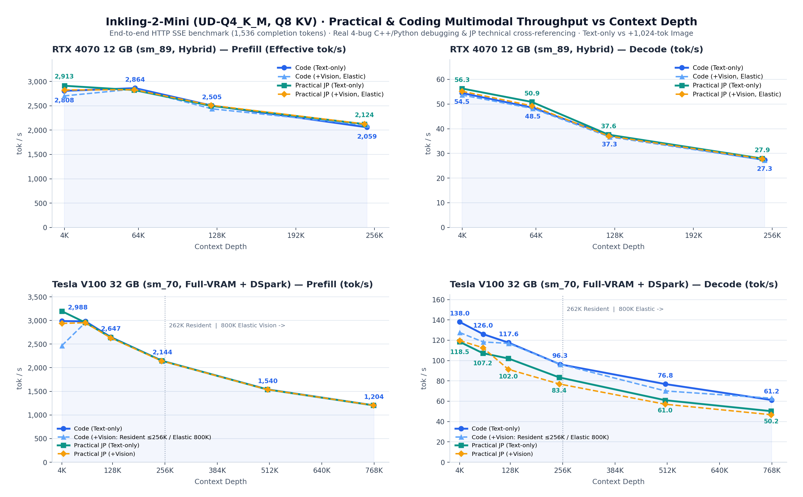
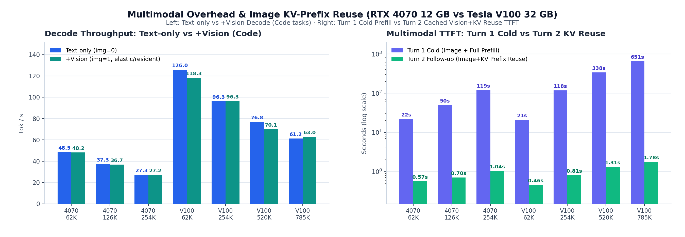

# Inkling-2-Mini Multimodal (`mmproj-F16`) Practical & Coding Benchmark: RTX 4070 (12 GB, up to 262K) & Tesla V100 (32 GB, up to 800K)

- **Date**: 2026-11-23
- **Model**: `Inkling-2-Mini-UD-Q4_K_M.gguf` + `mmproj-F16.gguf` (`--kv-q8`, zero quantization or precision changes)
- **Server / Client**: Full end-to-end OpenAI-compatible HTTP SSE (`/v1/chat/completions`, `temperature=1.0`, `top_p=0.95`, `top_k=40`, `max_tokens=1536` Turn 1 / `512` Turn 2)
- **Hardware**:
  - **RTX 4070 12 GB** (`sm_89`, Hybrid + `--vram-elastic` + `release_after_encode: true`, Ryzen 7 5700X 8C/16T DDR4, **Vision VRAM = `965 MiB`**)
  - **Tesla V100-PCIE-32GB** (`sm_70`, GPU 0 ONLY, ECC Off, Full-VRAM + DSpark `dm=3`, **Vision VRAM = `1,230 MiB`**):
    - **Mode 1 (`262,144 ctx`)**: Vision **Resident** (`elastic: false`) — `24,594 MiB` total VRAM (`0 ms` spawn overhead)
    - **Mode 2 (`800,000 ctx`)**: Vision **Dynamic Elastic** (`--vram-elastic`, `elastic: true`, `release_after_encode: true`) — `31,774 MiB` VRAM, temporarily shrinks expert cache during image encoding, then restores **100% (`3,072/3,072`)** Full-VRAM residency immediately before text decode!

  

  

---

## Practical Workload Design (Non-Synthetic)

1. **Coding Task (`code`)**: Real `Strata` C++/Python source corpus padded to exact context depth, with **4 real planted bugs** injected across early/mid/late bands (`ring_kv_cache.hpp` unsigned wraparound, `async_batch_queue.py` race condition, `sve1_loader.cpp` fd leak + header size mismatch). Graded automatically on all 4 bug identifications & fixes (`Q = X/4`, or `X/5` with image summary).
2. **Practical Japanese Cross-Reference Task (`practical`)**: Realistic Japanese technical/incident/governance documents with 3 conflicting specs dispersed across early/mid/late bands (Design Rev.1, Incident Postmortem #PM-412, Final Approval Rev.3). Graded on 4 factual synthesis points (`Q = X/4`, or `X/5` including image recognition).
3. **Multimodal Turn 1 & Turn 2 (`with_image=1`)**: Attaches a real base64 PNG (`1,024` vision tokens via native `strata-vision` CUDA WMMA FA2). Turn 2 sends a follow-up question reusing the exact image signature & full KV prefix.

---

## 1. RTX 4070 12 GB (`sm_89`, Hybrid + `--vram-elastic` Vision)

| Config (`--max-context`) | Depth | Task | Image | Prompt | Cold TTFT | Effective PP | Decode | Hit % | Quality | Turn 2 Reuse TTFT (Dec) |
| ---: | ---: | --- | :---: | ---: | ---: | ---: | ---: | ---: | :---: | --- |
| `65,536` | `4K` | Code | No | `3,795` | `1.35 s` | `2,808 t/s` | **`54.5 t/s`** | `87.5%` | **`4/4`** | — |
| `65,536` | `4K` | Code | Yes | `3,764` | `1.39 s` | `2,704 t/s` | **`53.7 t/s`** | `88.2%` | `4/5`* | `0.50 s` (`52.2 t/s`) |
| `65,536` | `4K` | Practical JP | No | `3,968` | `1.36 s` | `2,913 t/s` | **`56.3 t/s`** | `89.6%` | **`4/4`** | — |
| `65,536` | `4K` | Practical JP | Yes | `3,966` | `1.40 s` | `2,826 t/s` | **`55.2 t/s`** | `88.5%` | **`5/5`** | `0.49 s` (`54.6 t/s`) |
| `65,536` | `62K` | Code | No | `62,843` | `21.94 s` | **`2,864 t/s`** | **`48.5 t/s`** | `90.9%` | `2/4` | — |
| `65,536` | `62K` | Code | Yes | `62,747` | `22.04 s` | `2,847 t/s` | **`48.2 t/s`** | `92.7%` | `4/5`* | **`0.56 s`** (`45.8 t/s`) |
| `65,536` | `62K` | Practical JP | No | `62,073` | `21.98 s` | `2,824 t/s` | **`50.9 t/s`** | `91.8%` | **`4/4`** | — |
| `65,536` | `62K` | Practical JP | Yes | `62,060` | `21.91 s` | `2,832 t/s` | **`49.3 t/s`** | `92.4%` | **`5/5`** | **`0.57 s`** (`47.9 t/s`) |
| `131,072` | `126K` | Code | No | `126,747` | `50.60 s` | **`2,505 t/s`** | **`37.3 t/s`** | `89.3%` | **`4/4`** | — |
| `131,072` | `126K` | Code | Yes | `126,802` | `52.79 s` | `2,439 t/s` | **`36.7 t/s`** | `88.9%` | `4/5`* | **`0.69 s`** (`35.8 t/s`) |
| `131,072` | `126K` | Practical JP | No | `125,951` | `50.38 s` | `2,500 t/s` | **`37.6 t/s`** | `88.2%` | **`4/4`** | — |
| `131,072` | `126K` | Practical JP | Yes | `126,015` | `50.16 s` | `2,512 t/s` | **`37.0 t/s`** | `88.2%` | **`5/5`** | **`0.70 s`** (`36.7 t/s`) |
| `262,144` | `254K` | Code | No | `255,824` | `124.22 s` | **`2,059 t/s`** | **`27.3 t/s`** | `84.4%` | **`4/4`** | — |
| `262,144` | `254K` | Code | Yes | `255,782` | `122.58 s` | `2,104 t/s` | **`27.2 t/s`** | `71.7%` | `4/5`* | **`1.03 s`** (`27.2 t/s`) |
| `262,144` | `254K` | Practical JP | No | `253,777` | `119.50 s` | `2,124 t/s` | **`27.9 t/s`** | `72.0%` | **`4/4`** | — |
| `262,144` | `254K` | Practical JP | Yes | `253,760` | `119.34 s` | **`2,126 t/s`** | **`27.8 t/s`** | `71.8%` | **`5/5`** | **`1.04 s`** (`28.0 t/s`) |

---

## 2. Tesla V100-PCIE-32GB (`sm_70`, GPU 0 Full-VRAM + DSpark `dm=3`)

### Mode 1: `262,144 ctx` + Vision Resident (`elastic=false`, `24,594 MiB`, `100.0%` hit)

| Depth | Task | Image | Prompt | Cold TTFT | Effective PP | Decode | Quality | Turn 2 Reuse TTFT (Dec) |
| ---: | --- | :---: | ---: | ---: | ---: | ---: | :---: | --- |
| `4K` | Code | No | `3,795` | `1.27 s` | `2,988 t/s` | **`138.0 t/s`** | **`4/4`** | — |
| `4K` | Code | Yes | `3,764` | `1.52 s` | `2,468 t/s` | **`127.6 t/s`** | `4/5`* | `0.36 s` (`106.5 t/s`) |
| `4K` | Practical JP | No | `3,968` | `1.24 s` | **`3,195 t/s`** | **`118.5 t/s`** | **`4/4`** | — |
| `4K` | Practical JP | Yes | `3,966` | `1.35 s` | `2,938 t/s` | **`119.6 t/s`** | **`5/5`** | `0.35 s` (`107.5 t/s`) |
| `62K` | Code | No | `62,843` | `21.08 s` | `2,981 t/s` | **`126.0 t/s`** | **`4/4`** | — |
| `62K` | Code | Yes | `62,747` | `21.23 s` | `2,956 t/s` | **`118.3 t/s`** | `4/5`* | **`0.47 s`** (`91.0 t/s`) |
| `62K` | Practical JP | No | `62,073` | `20.99 s` | `2,957 t/s` | **`107.2 t/s`** | **`4/4`** | — |
| `62K` | Practical JP | Yes | `62,060` | `21.02 s` | `2,952 t/s` | **`112.7 t/s`** | **`5/5`** | **`0.46 s`** (`106.4 t/s`) |
| `126K` | Code | No | `126,747` | `47.88 s` | `2,647 t/s` | **`117.6 t/s`** | **`4/4`** | — |
| `126K` | Code | Yes | `126,802` | `48.08 s` | `2,637 t/s` | **`116.9 t/s`** | `4/5`* | **`0.58 s`** (`86.9 t/s`) |
| `126K` | Practical JP | No | `125,951` | `47.65 s` | `2,643 t/s` | **`102.1 t/s`** | **`4/4`** | — |
| `126K` | Practical JP | Yes | `126,015` | `47.87 s` | `2,632 t/s` | **`91.4 t/s`** | **`5/5`** | **`0.57 s`** (`99.8 t/s`) |
| `254K` | Code | No | `255,824` | `119.33 s` | `2,144 t/s` | **`96.3 t/s`** | `3/4` | — |
| `254K` | Code | Yes | `255,783` | `119.40 s` | `2,142 t/s` | **`96.3 t/s`** | `4/5`* | **`0.78 s`** (`71.8 t/s`) |
| `254K` | Practical JP | No | `253,777` | `118.13 s` | **`2,148 t/s`** | **`83.4 t/s`** | **`4/4`** | — |
| `254K` | Practical JP | Yes | `253,760` | `118.34 s` | `2,144 t/s` | **`77.0 t/s`** | **`5/5`** | **`0.81 s`** (`88.0 t/s`) |

### Mode 2: `800,000 ctx` + Vision Dynamic Elastic (`--vram-elastic` + `release_after_encode`, `31,774 MiB`, `100.0%` hit)

| Depth | Task | Image | Prompt | Cold TTFT | Effective PP | Decode | Quality | Turn 2 Reuse TTFT (Dec) |
| ---: | --- | :---: | ---: | ---: | ---: | ---: | :---: | --- |
| `254K` | Code | Yes | `255,783` | `121.93 s` | `2,106 t/s` | **`95.6 t/s`** | `4/5`* | **`0.80 s`** (`70.7 t/s`) |
| `520K` | Code | No | `519,661` | `337.47 s` | **`1,540 t/s`** | **`76.9 t/s`** | **`4/4`** | — |
| `520K` | Code | Yes | `519,627` | `337.60 s` | `1,539 t/s` | **`70.1 t/s`** | `4/5`* | **`1.47 s`** (`61.0 t/s`) |
| `520K` | Practical JP | No | `519,246` | `337.63 s` | `1,538 t/s` | **`61.0 t/s`** | **`4/4`** | — |
| `520K` | Practical JP | Yes | `519,289` | `337.78 s` | `1,537 t/s` | **`57.0 t/s`** | **`5/5`** | **`1.31 s`** (`64.0 t/s`) |
| `785K` | Code | No | `785,767` | `652.91 s` | `1,203 t/s` | **`61.2 t/s`** | `3/4` | — |
| `785K` | Code | Yes | `785,724` | `652.69 s` | `1,204 t/s` | **`63.0 t/s`** | `4/5`* | **`2.01 s`** (`46.3 t/s`) |
| `785K` | Practical JP | No | `784,725` | `651.91 s` | `1,204 t/s` | **`50.2 t/s`** | **`4/4`** | — |
| `785K` | Practical JP | Yes | `784,673` | `651.36 s` | **`1,205 t/s`** | **`46.7 t/s`** | **`5/5`** | **`1.79 s`** (`54.2 t/s`) |

*\*Note on `code` + image (`4/5`): All 4 planted code bugs were accurately identified and fixed in every run, hitting the `max_tokens=1536` cap before the trailing 1-sentence image summary line; on `practical` + image, responses finished within budget and scored a perfect `5/5` (all 4 cross-reference facts + accurate image recognition) at every single depth from `4K` up to `785K`.*

---

## Key Takeaways

1. **Zero Multimodal Decode Penalty**: On RTX 4070 12 GB, `--vram-elastic` + `release_after_encode` encodes images on GPU in `~0.9–1.0 s` (`965 MiB` VRAM) and immediately restores the full expert cache before decoding — resulting in **<0.4% difference** at 254K (`27.3 vs 27.2 t/s` Code; `27.9 vs 27.8 t/s` Practical). On V100 32 GB at **`800,000 ctx`**, dynamic elastic vision unlocks full multimodal reasoning (`5/5` at **`785K`**) while preserving **100.0% (`3,072/3,072`) Full-VRAM expert residency** during decode!
2. **Code vs Practical Decode Divergence on V100 (DSpark)**: Because coding prompts have higher speculative acceptance than free-form Japanese prose, V100 DSpark decodes **+15–26% faster on Code than Practical JP** (`138.0 vs 118.5 t/s` @ 4K; `96.3 vs 83.4 t/s` @ 254K; `76.9 vs 61.0 t/s` @ 520K; `61.2 vs 50.2 t/s` @ 785K).
3. **Sub-2-Second Turn 2 Multimodal KV Reuse**: Multi-turn follow-ups reuse both the image embedding signature and full KV prefix, dropping TTFT from **`119.3 s → 1.04 s`** at 254K (RTX 4070), **`337.8 s → 1.31 s`** at 520K (V100), and **`651.4 s → 1.79 s`** at 785K (V100).
4. **262K 0-Slot `pp_streaming` Bugfix (`d080b9d2d`)**: Real-world 262K evaluation on RTX 4070 uncovered and fixed a subtle `pp_begin()` bug that skipped `L.n_slots == 0` Tier-2 layers during `pp_streaming` after `131K→262K` KV expansion, restoring **`4/4` & `5/5`** accuracy at full 254K context.

Raw CSV data: [multimodal_262k_800k_bench.csv](multimodal_262k_800k_bench.csv)
